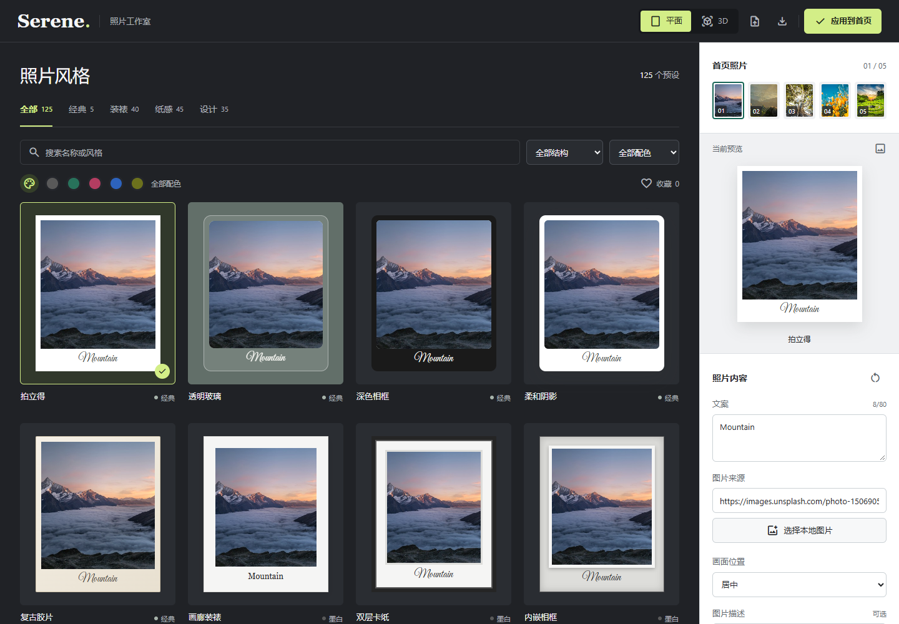
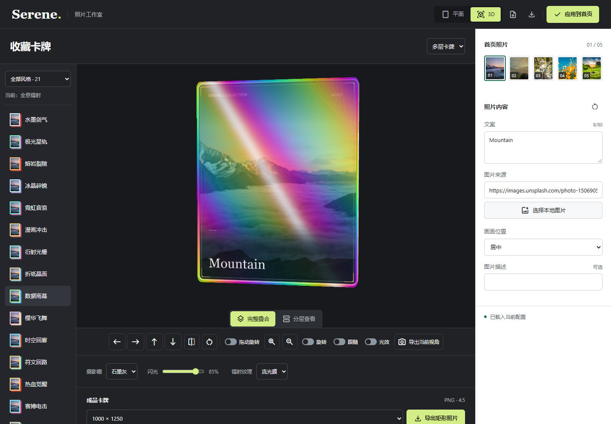
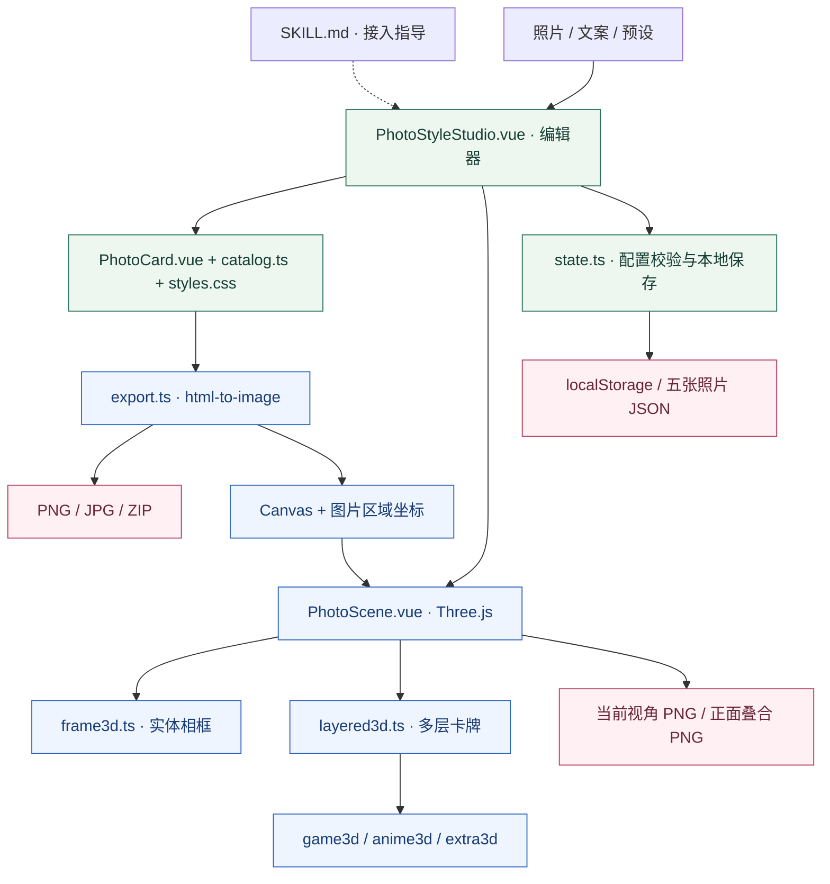

<div align="center">

# Photo Card Styles

**把你的照片，做成自己的收藏卡。**

125 个平面预设 · 21 种多层特效 · 6 种实体相框

Vue 3 / TypeScript / Three.js / MIT

[效果图鉴](docs/gallery.md) · [技术架构](docs/architecture.md) · [接入指南](references/integration.md) · [开源许可](LICENSE)

</div>

| 全息镭射 · HOLO | 热血觉醒 · AWAKENING | 秘金圣器 · MYTHIC |
| :---: | :---: | :---: |
|  |  |  |

以上是同一张示例照片经过组件**实际导出的 PNG**，不是设计稿，也不是 AI 生成效果。原始图片尺寸为 1000 × 1250；动态反光在静态图中只保留一个固定相位。

> 这是可复用的 **编码助手 Skill + Vue 组件源码**，不是开箱即用的网站。你可以让助手接入现有项目，也可以直接使用组件。无需 Serene 后端或 API Key。

## 一张照片，三种表达

| 路径 | 能做什么 | 对应实现 |
| --- | --- | --- |
| 平面排版 | 5 个经典款 + 24 种结构 × 5 套配色，共 125 个预设 | [PhotoCard.vue](assets/PhotoCard.vue) + [catalog.ts](assets/catalog.ts) |
| 实体相框 | 6 种相框、材质、厚度、旋转和亮度估算浮雕 | [PhotoScene.vue](assets/PhotoScene.vue) + [frame3d.ts](assets/frame3d.ts) |
| 多层卡牌 | 21 种镭射、动漫、游戏与创意特效；完整叠合或分层检查 | [layered3d.ts](assets/layered3d.ts) 及特效模块 |

### 平面工作室



选择结构与配色，替换本地照片或图片 URL，再修改文案、画面位置和图片描述。默认编辑器提供五个照片位置；图片与风格独立配置。

### 立体工作室



完整叠合是成品视图，分层查看用于检查装饰层。支持方向按钮、键盘、可开启的拖动旋转与动态光效控制。截图展示的是 Serene 中的集成实例，品牌与导航需要在接收项目中适配。

## 用你自己的照片

### 1. 安装 Skill

将仓库克隆到本机的 `~/.codex/skills/photo-card-styles/`。自定义了 `CODEX_HOME` 时，改用其下的 `skills/photo-card-styles/`。

```sh
git clone https://github.com/chenzehaoo/photo-card-styles.git ~/.codex/skills/photo-card-styles
```

确认 `SKILL.md` 位于该目录根部，然后在新对话中提出需求：

```text
使用 $photo-card-styles 接入我的 Vue 项目。
用我提供的照片和文案，保留现有卡片尺寸。
提供全息镭射与热血觉醒风格，并支持带边框、特效和文案的成品 PNG 导出。
```

### 2. 替换照片与文案

在工作室选择照片位置，使用“选择本地图片”或填写图片地址，修改文案后选择风格。不要把私人照片、个人配置 JSON 或登录凭据提交到仓库。

### 3. 选择正确的导出

| 目标 | 操作 | 输出内容 |
| --- | --- | --- |
| 平面卡片 | 平面导出面板 | PNG / JPG，可选五张 ZIP；最高 2000 × 2500 |
| 当前 3D 姿态 | 导出当前视角 | 保留当前相机、姿态及场景背景的 PNG 截图 |
| 完整多层卡牌 | 导出矩形照片 | 正面叠合成品 PNG，1000 × 1250 或 2000 × 2500 |

成品导出**保留完整边框、特效和文案**。圆角外的四角使用对齐的照片底层补齐，不通过压缩边框、裁掉装饰或拉伸图层填充。即使当前正在分层查看，成品也会完整叠合。查看 [效果与导出对照](docs/gallery.md#预览与成品不是同一种输出)。

## 技术架构



渲染和导出在浏览器完成，远程图片仍需要网络访问与 CORS 支持。Skill 是接入说明，不是运行时服务；本地存储也不是云端同步。更多模块职责、数据流及成品导出流程见 [技术架构详解](docs/architecture.md)。

## 接入 Vue 项目

只使用平面卡片，复制 `assets/PhotoCard.vue`、`assets/catalog.ts`、`assets/styles.css` 和整个 `assets/fonts/`：

```vue
<script setup lang="ts">
import PhotoCard from './photo-card-styles/PhotoCard.vue';
</script>

<template>
  <PhotoCard :card="{
    id: 'summer',
    image: '/photos/summer.jpg',
    type: 'postcard-jade',
    label: 'Summer memories',
    position: 'center'
  }" />
</template>
```

把自己的照片放到接收项目的 `public/photos/summer.jpg`。可编辑示例见 [BasicPhoto.vue](examples/BasicPhoto.vue)，需要已有 Vue 3 构建环境。

<details>
<summary><strong>完整工作室依赖与接入注意事项</strong></summary>

复制整个 `assets/`，安装项目已使用的依赖版本：

```sh
npm install vue@^3.4.21 three@0.184.0 html-to-image@1.11.13 fflate@0.8.3
npm install --save-dev @types/three@0.184.1
```

这些是已使用的版本，不表示最新版本。已有 Vue 时先检查兼容性，不要直接覆盖依赖。

将 `PhotoStyleStudio.vue` 挂到路由，加载 Material Symbols 字体或替换为已有图标库。适配 Serene 品牌、返回首页链接、应用按钮和存储键。SSR 项目将浏览器相关模块作为仅客户端组件加载。详见 [接入指南](references/integration.md)。

</details>

## 边界与限制

- 125 指预设数量，不是 125 种完全不同的结构；21 种特效和 6 种相框独立计数。
- 默认卡片尺寸：桌面 200 × 250、平板 170 × 215、手机 150 × 190 CSS 像素。
- JSON 保存五张平面卡片配置，不含 3D 相机、材质设置或自定义深度图。
- 动漫效果是照片上的装饰叠加，不是 AI 动漫转换、主体抠图或真实场景重建。
- PNG 是静态图片；暂不支持 GIF、视频、GLB 或 OBJ 导出。
- 目标平台是浏览器/H5；小程序、原生端及其他框架需要适配。
- 远程图片受 CORS 限制；高分辨率导出不会恢复源照片中不存在的细节。

## 检查与贡献

```sh
node scripts/verify-package.mjs
```

需要 Node.js 18+。检查必需文件、相对导入、字体许可、文档本地链接与常见凭证残留，不替代安全审计或浏览器测试。修改渲染代码后，还应检查桌面/手机交互及实际导出像素。

欢迎通过 [Issues](https://github.com/chenzehaoo/photo-card-styles/issues) 反馈，或提交 PR。复现问题时请附浏览器版本、预设 ID、操作步骤与脱敏截图。

## 许可与素材

原创代码与文档采用 [MIT](LICENSE)，允许使用、修改、分发和商业使用，须保留版权与许可声明。字体、依赖和示例照片遵循各自许可。效果图使用项目内置 Unsplash 示例照片；照片本身不因出现在本仓库而变为 MIT 授权。详见 [第三方声明](THIRD_PARTY_NOTICES.md) 与 [效果图来源](docs/gallery.md#素材与复现)。

<div align="center">

维护者 [chenzehaoo](https://github.com/chenzehaoo) · [查看源码](https://github.com/chenzehaoo/photo-card-styles)

</div>
