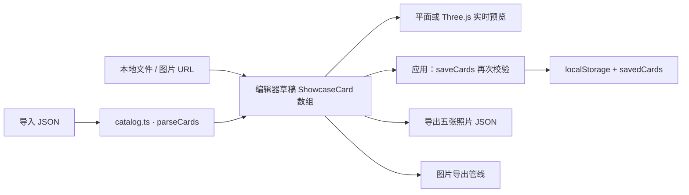
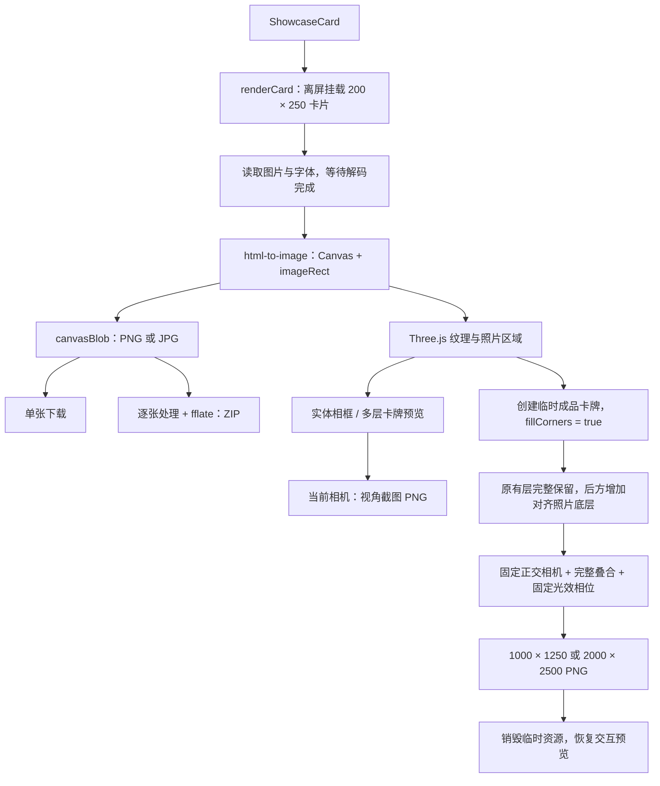

# 技术架构

[返回首页](../README.md) · [效果图鉴](gallery.md) · [详细接入](../references/integration.md)

## 设计边界

这是浏览器端组件包。`SKILL.md` 指导编码助手接入组件；Vue 管理状态与界面，CSS 绘制平面样式，Three.js 绘制相框与特效。没有独立后端、照片上传服务或 AI 推理服务。

## 模块地图

| 层 | 文件 | 职责 |
| --- | --- | --- |
| Skill | `SKILL.md`、`agents/openai.yaml` | 接入约束、助手发现与使用说明 |
| 编辑器 | `PhotoStyleStudio.vue` | 五张照片草稿、筛选、收藏、图片替换、配置导入导出；懒加载 3D 和导出面板 |
| 数据 | `catalog.ts`、`state.ts` | 预设与数据类型、配置解析、localStorage 持久化 |
| 平面 | `PhotoCard.vue`、`styles.css`、`fonts/` | 固定尺寸照片、装饰、文案和字体 |
| 媒体 | `export.ts`、`ExportPanel.vue` | 离屏挂载、图片字体嵌入、Canvas 截取、PNG/JPG 和顺序 ZIP 打包 |
| 场景 | `PhotoScene.vue` | WebGL 生命周期、相机、灯光、交互、场景截图和独立成品导出 |
| 相框 | `frame3d.ts` | 六种实体相框的几何与材质 |
| 卡牌 | `layered3d.ts` | 21 种预设目录、分层组装、照片与文案、薄膜、层间距 |
| 特效 | `game3d.ts`、`anime3d.ts`、`extra3d.ts` | 游戏 3 种、动漫 3 种、创意 12 种；其余 3 种薄膜卡牌由分层模块提供 |
| 交互基础 | `NativeButton.ts`、`NativeField.ts`、`studio-tokens.css` | 原生控件语义与共享视觉样式 |

上表除 Skill 文件外，组件文件都位于 [`assets/`](../assets)。

## 数据如何流动

核心数据是 `ShowcaseCard`：`id`、`image`、`type`、`label`，以及可选的 `alt`、`position`。3D 相机、分层参数和深度图属于临时场景状态，不包含在这份配置中。接收项目可消费 `savedCards`，但需要自行适配首页与应用按钮。

## 两条图像导出管线

### 为什么圆角外不会留空

`buildLayeredCard(..., true)` 在所有原有层后方增加一张照片底层，沿用相同的照片映射。边框、薄膜、文字和其他原有图层保留原本几何与比例。固定正交相机的水平范围是 `-1..1`，垂直范围是 `-1.25..1.25`，与 4:5 成品对应。

这里的“完整”指完整保留卡牌组成，不表示任意比例的输入照片都能无裁切显示；照片可见区域仍由卡片结构与画面位置决定。

### 为什么分层预览不会被直接导出

成品使用临时构造的叠合卡牌和独立正面相机，不把当前旋转、分层间距和摄影棚背景当作成品构图。动态效果使用固定相位生成可复现静帧。若需要当前姿态和背景，应选择“导出当前视角”。

## 运行与资源约束

- `renderCard` 完成后卸载离屏 Vue 实例；场景销毁时释放 Three.js 资源。
- 图片与字体加载失败会阻止导出；远程图片必须允许 CORS。
- 浏览器本地保存不是服务器备份，浏览器清理或存储配额可能影响配置。
- 相框是几何模型；默认浮雕深度来自亮度估算，不是 AI 恢复场景。
- WebGL、Canvas、DOM 和 localStorage 都是浏览器能力，SSR 需客户端加载。

## 修改后的验证清单

1. 运行包校验及接收项目的类型检查、构建。
2. 桌面与手机检查尺寸、滚动、图片替换、文案和键盘操作。
3. 检查 PNG/JPG 解码尺寸、ZIP 内容及失败提示。
4. 检查完整叠合与分层预览下导出的成品一致，边框没有压缩。
5. 检查成品四角像素、非空渲染、动画暂停以及资源恢复。

文档截图不是上述全部测试的替代品；运行时改动后应重新执行相关验证。
