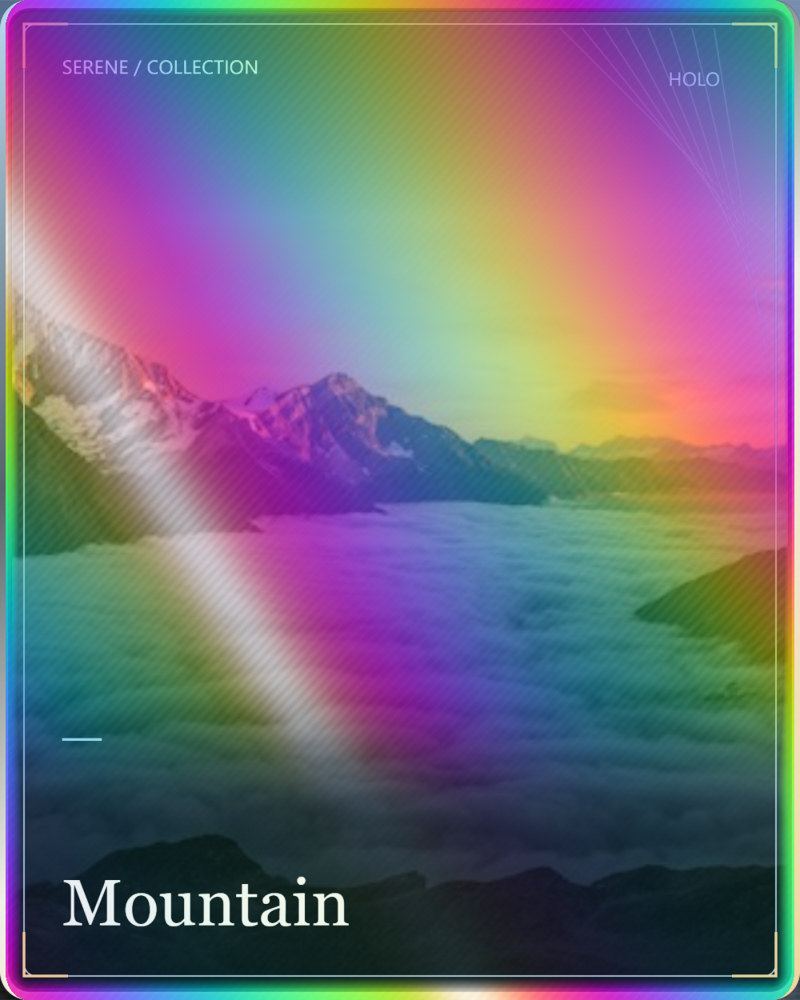
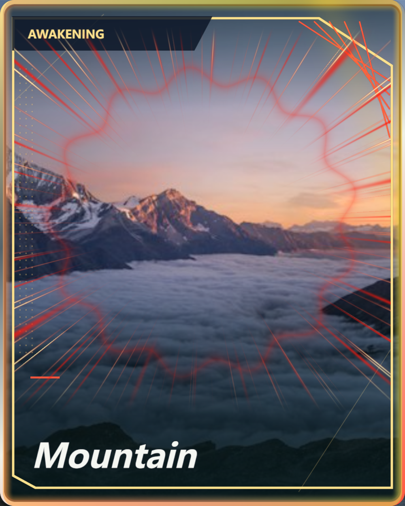
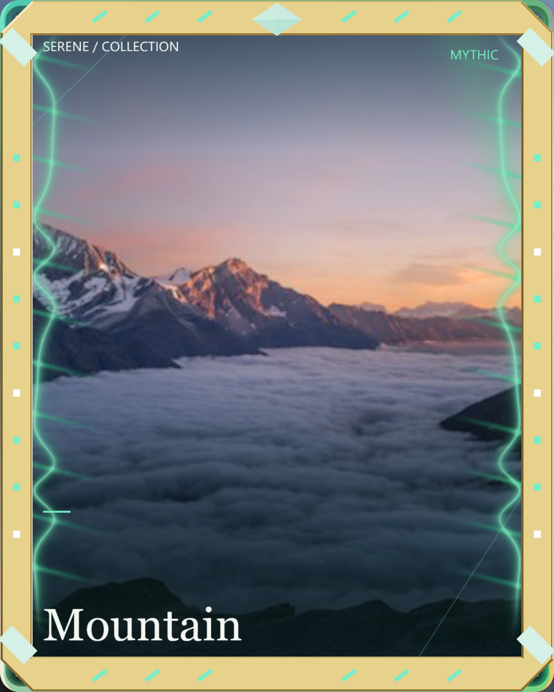
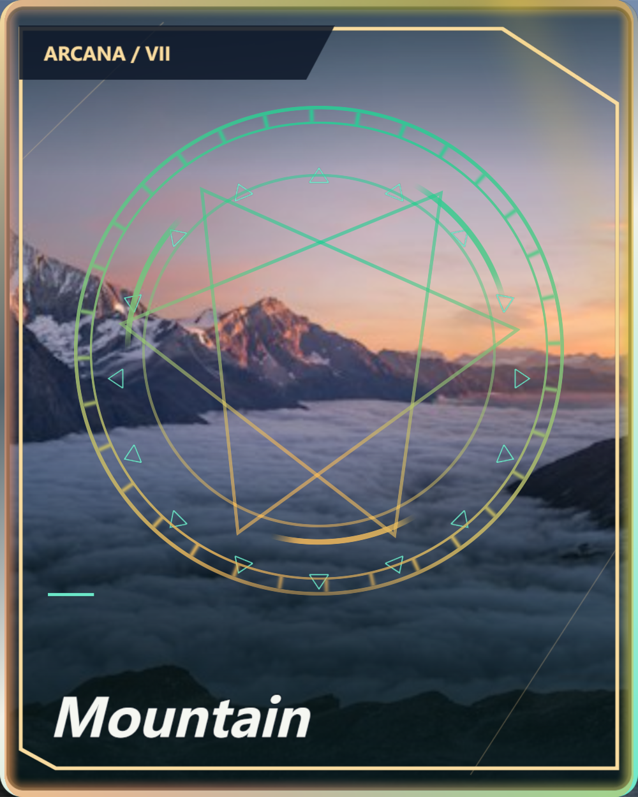
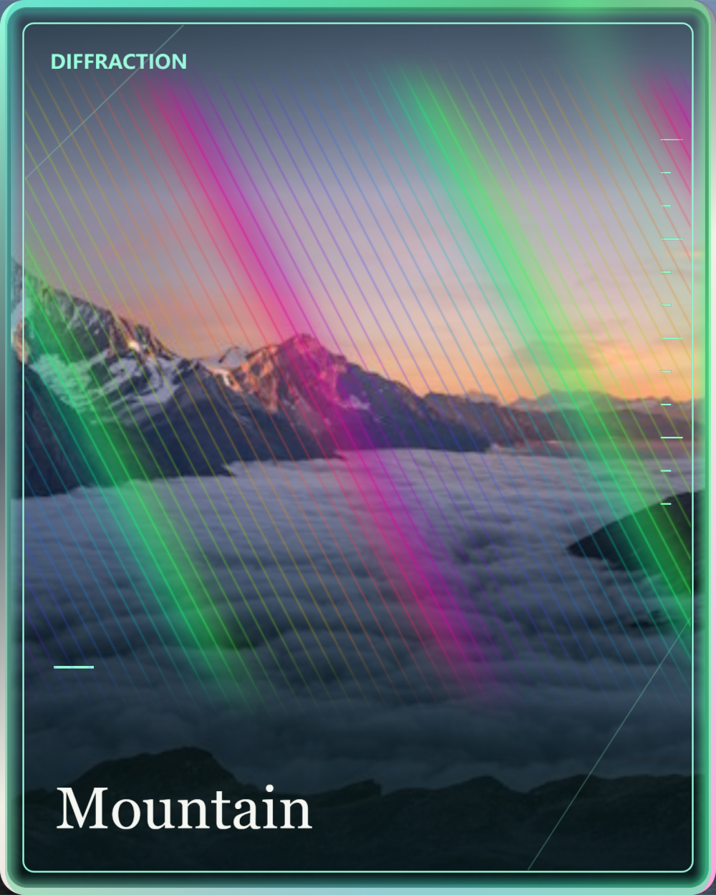
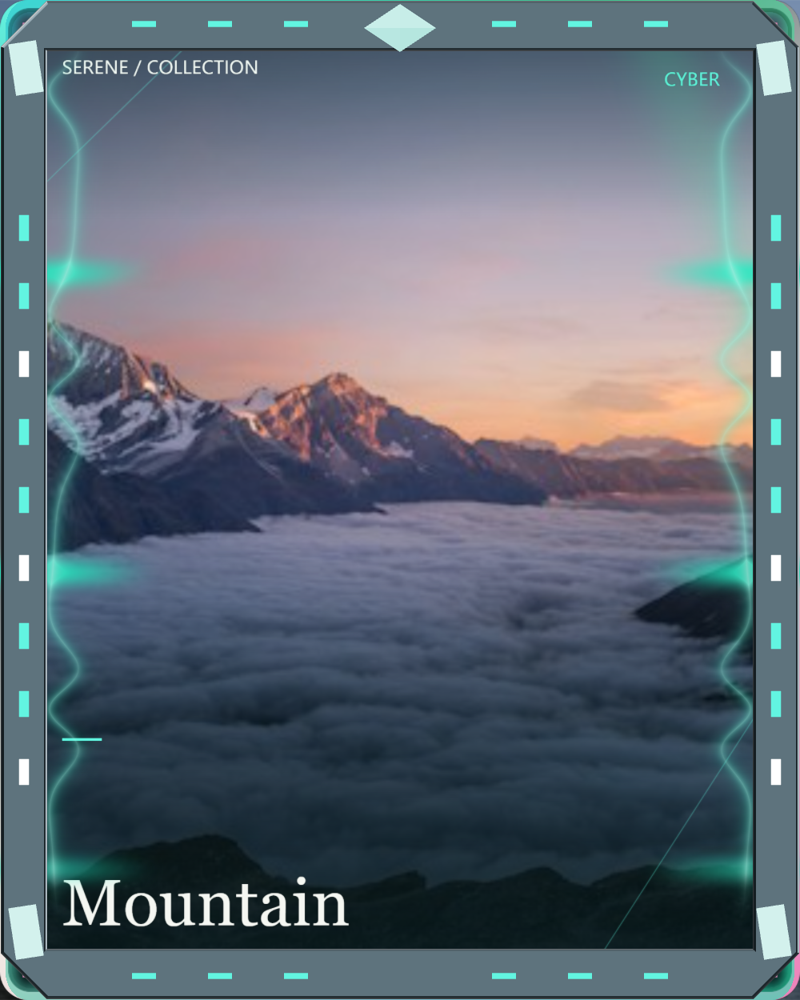
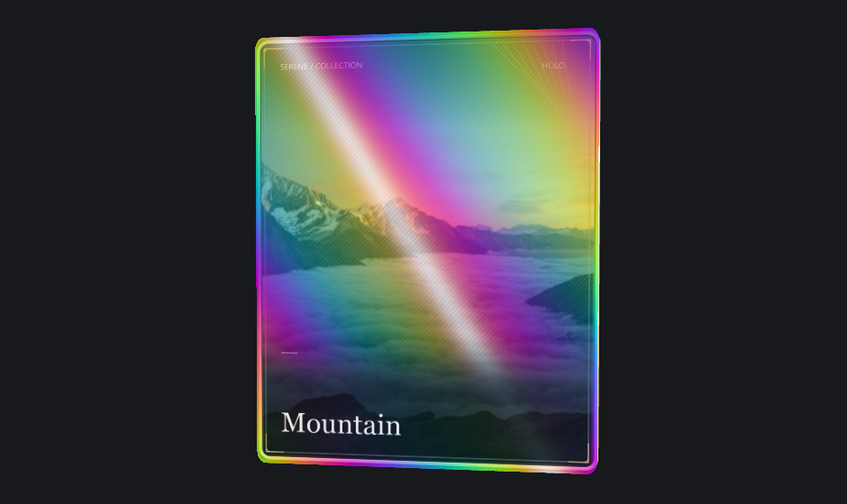
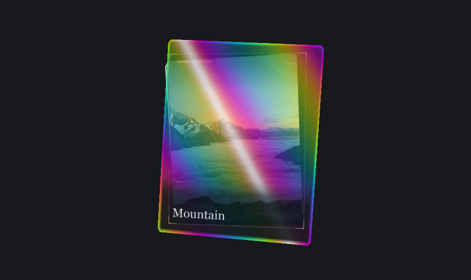

# 效果图鉴

[返回首页](../README.md) · [技术架构](architecture.md) · [接入指南](../references/integration.md)

下面六张图片来自实际“导出矩形照片”，统一使用默认 Mountain 照片与文案，方便比较装饰差异。成品尺寸均为 **1000 × 1250 PNG**，不是概念设计图。

## 镭射、动漫与游戏

| 全息镭射 `holo` | 热血觉醒 `awakening` | 秘金圣器 `mythic` |
| :---: | :---: | :---: |
|  |  |  |
| 光谱薄膜与角度反光 | 放射速度线与能量纹理 | 金属几何与符文装饰 |

| 魔法召唤 `summon` | 衍射光栅 `diffraction` | 赛博机甲 `cyber` |
| :---: | :---: | :---: |
|  |  |  |
| 魔法阵与多层符号 | 光谱光栅与干涉纹理 | 切角装甲与能量细节 |

这些效果是在照片上叠加材质、几何与程序化图案，不会把照片中的人物自动转换成动漫人物。PNG 不保存动画或交互。

## 全部 21 种卡牌特效

| 分类 | 数量 | 风格 |
| --- | ---: | --- |
| 薄膜 | 3 | 全息镭射、霓虹叠影、晶透棱镜 |
| 动漫 | 3 | 热血觉醒、赛博电击、魔法召唤 |
| 游戏 | 3 | 秘金圣器、赛博机甲、冰晶契约 |
| 创意 | 12 | 水墨剑气、极光星轨、熔岩裂隙、冰晶碎镜、霓虹音浪、漫画冲击、衍射光栅、折纸晶面、数据雨幕、樱华飞舞、时空回廊、符文回路 |

## 预览与成品不是同一种输出

| 完整叠合预览 | 分层检查预览 |
| :---: | :---: |
|  |  |
| 查看各层组成的整体效果 | 查看前后层次和装饰结构 |

两张图都是场景截图，包含摄影棚背景。无论在哪种预览状态下选择“导出矩形照片”，输出的都是上方那样的**正面、完整叠合、没有摄影棚留边**的成品。

圆角外的四角由对齐照片底层补齐，原有边框不会缩小或被裁掉。照片在卡片内的构图依然受输入比例、预设结构与画面位置影响。

## 素材与复现

- 本组图片由当前组件在浏览器中截图或导出，无额外重绘；界面截图为 Serene 集成实例。
- 成品使用默认第一张 Mountain 照片、默认文案与全息纹理，分辨率选择 1000 × 1250。逐一选择表中的预设，再点击“导出矩形照片”即可复现；不同 GPU 或字体渲染可能产生微小差异。
- 山景源图：[Unsplash 图片资源](https://images.unsplash.com/photo-1506905925346-21bda4d32df4)。工作室截图中的其他缩略图来自 [`catalog.ts`](../assets/catalog.ts) 内的四个示例 URL。
- 照片来源遵循 [Unsplash License](https://unsplash.com/license)，不适用本项目 MIT 许可。这里分发的是功能演示图，不是独立照片素材包。其他字体与依赖许可见 [第三方声明](../THIRD_PARTY_NOTICES.md)。
- 示例源图本身尺寸有限；导出更大图片不会增加原始照片细节。正式作品请替换为自己有权使用的清晰照片。
